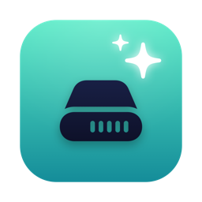
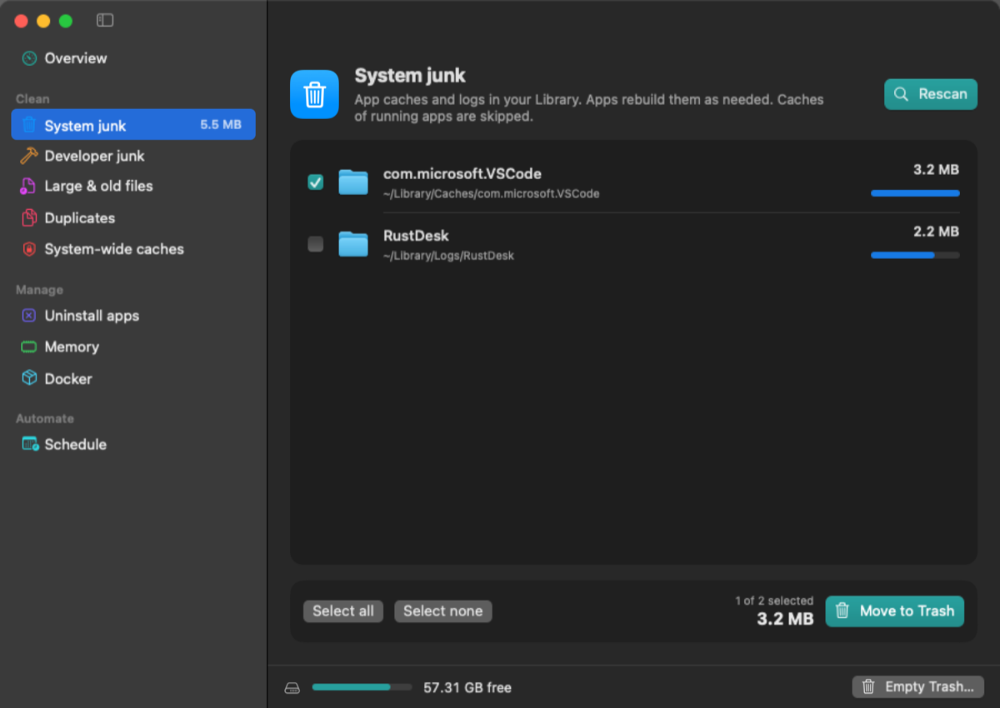
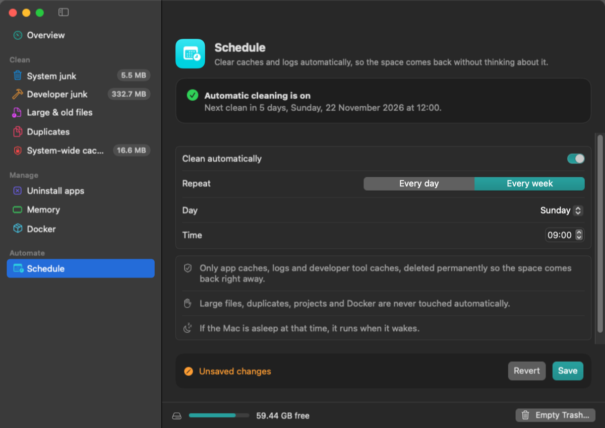

<p align="center"></p>

<h1 align="center">Sweep</h1>

<p align="center">A small, native macOS cleaner. Scan, review, then clean: nothing is removed without you seeing it first.</p>


## Features

| Section | What it does |
|---|---|
| **Overview** | Disk usage at a glance; **Smart Scan** checks every cleanable section at once |
| **System junk** | App caches and logs in `~/Library` (skips caches of running apps) |
| **Developer junk** | npm, yarn, pnpm, bun, gradle, cargo, uv caches, Xcode DerivedData, `node_modules` in projects untouched for 30+ days |
| **Large & old files** | Files over 100 MB, or over 10 MB and unopened for 180 days, in Downloads, Desktop and Documents |
| **Duplicates** | Identical files (SHA-256), oldest copy kept as the original |
| **System-wide caches** | `/Library/Caches` and `/Library/Logs`, via the macOS admin prompt |
| **Uninstall apps** | Removes an app plus the leftover files it keeps in `~/Library` |
| **Memory** | RAM in use and the heaviest processes, with Quit |
| **Docker** | Removes build cache and unused images; never containers or volumes |
| **Schedule** | Optional daily or weekly cache clean at a time you choose (launchd) |



## Safety

- Everything goes to the **Trash** first, so you can put it back. Only system caches, Docker cleanup and the scheduled clean delete permanently, and each says so.
- A path gate refuses anything outside safe locations (at least two levels inside your home folder, or a top-level app in `/Applications`). Admin deletes only accept paths inside `/Library/Caches/` or `/Library/Logs/`.
- Sweep never sees your password; macOS shows its own prompt.
- `com.apple.*` items and caches of running apps are skipped. iCloud-only files are never downloaded during a scan.



## Build

Needs macOS 15+ and the Swift command line tools (Xcode not required).

```bash
./make-app.sh      # builds a release binary, wraps it in Sweep.app, installs to /Applications
swift test         # runs the test suite
```

The app icon is drawn in code: edit `scripts/make-icon.swift` and run `swift scripts/make-icon.swift`.

### Command line

```bash
Sweep --scan                       # read-only report of system and developer junk
Sweep --trash PATH...              # move paths to the Trash through the same safety gate
Sweep --schedule off|daily|weekly  # set the automatic clean (12:00, Sundays for weekly)
Sweep --auto-clean                 # what the scheduled job runs
```

## Project layout

```
Sources/SweepCore   scanning, safety checks, cleaning, Docker, schedule (tested)
Sources/Sweep       SwiftUI app and command line entry point
Tests               Swift Testing suite
docs                design spec and screenshots
```
