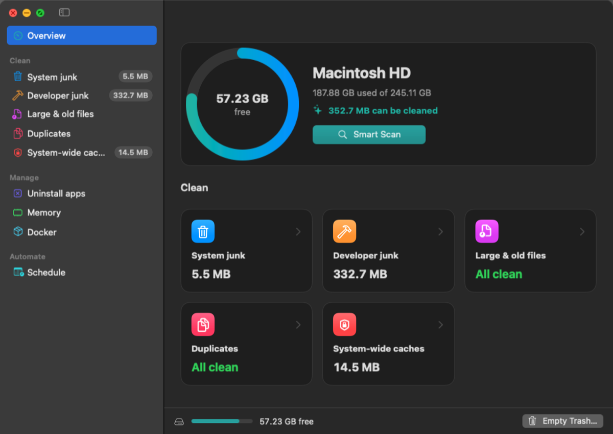

<p align="center"></p>

<h1 align="center">Sweep</h1>

<p align="center">A desktop cleaner for macOS and Windows. Scan, review, then clean.</p>

## Windows

1. Open [GitHub Releases](https://github.com/Arkwae99/sweep/releases/latest) on your Windows 11 laptop.
2. Under **Assets**, download `Sweep-Windows-x64-Setup.exe` for an Intel or AMD PC, or `Sweep-Windows-arm64-Setup.exe` for an ARM PC. Check **Settings → System → About → System type** if you are unsure.
3. Run the installer and open **Sweep** from the Start menu. The installer includes .NET and installs for the current user. The installer is unsigned, so Windows SmartScreen may show a warning.

**Cleanup** lists nonempty files last modified at least seven days ago in `%LOCALAPPDATA%\Temp` and at least 30 days ago in the default npm log, npm download and NuGet HTTP caches. Review the list, check the files you want removed and confirm **Delete selected**. This permanently deletes those files to recover disk space. Sweep skips locked, changed and redirected files.

**Memory** shows available RAM and the processes with the largest working sets. Use **Open Task Manager** to decide which running apps to close.

To build from source on Windows, install the .NET 10 SDK and run `dotnet run --project Windows/Sweep.App`. Run `dotnet test Windows/Sweep.Tests` for the Windows cleanup tests. Pushing a `vX.Y.Z` tag builds and publishes both installers after the checks pass.

## macOS



### Features

| Section | What it does |
|---|---|
| **Overview** | Disk usage at a glance; **Smart Scan** checks every cleanable section at once |
| **System junk** | App caches and logs in `~/Library` (skips caches of running apps) |
| **Developer junk** | npm, yarn, pnpm, bun, gradle, cargo, uv caches, Xcode DerivedData, `node_modules` in projects untouched for 30+ days |
| **Large & old files** | Files over 100 MB, or over 10 MB and unopened for 180 days, in Downloads, Desktop and Documents |
| **Duplicates** | Identical files (SHA-256), oldest copy kept as the original |
| **System-wide caches** | `/Library/Caches` and `/Library/Logs`, via the macOS admin prompt |
| **Uninstall apps** | Removes an app plus the leftover files it keeps in `~/Library` |
| **Memory** | RAM in use and the heaviest processes, with Quit |
| **Docker** | Removes build cache and unused images; never containers or volumes |
| **Schedule** | Optional daily or weekly cache clean at a time you choose (launchd) |


### Safety

- Everything goes to the **Trash** first, so you can put it back. Only system caches, Docker cleanup and the scheduled clean delete permanently, and each says so.
- A path gate refuses anything outside safe locations (at least two levels inside your home folder, or a top-level app in `/Applications`). Admin deletes only accept paths inside `/Library/Caches/` or `/Library/Logs/`.
- Sweep never sees your password; macOS shows its own prompt.
- `com.apple.*` items and caches of running apps are skipped. iCloud-only files are never downloaded during a scan.


### Build

Needs macOS 15+ and the Swift command line tools (Xcode not required).

```bash
./make-app.sh      # builds a release binary, wraps it in Sweep.app, installs to /Applications
swift test         # runs the test suite
```

The app icon is drawn in code: edit `scripts/make-icon.swift` and run `swift scripts/make-icon.swift`.

#### Command line

```bash
Sweep --scan                       # read-only report of system and developer junk
Sweep --trash PATH...              # move paths to the Trash through the same safety gate
Sweep --schedule off|daily|weekly  # set the automatic clean (12:00, Sundays for weekly)
Sweep --auto-clean                 # what the scheduled job runs
```

## Project layout

```
Sources/SweepCore   scanning, safety checks, cleaning, Docker, schedule (tested)
Sources/Sweep       SwiftUI app and command line entry point
Tests               Swift Testing suite
Windows             Windows desktop app, cleanup tests and per-user installer
docs                design spec and screenshots
```

## License

[MIT](LICENSE)
